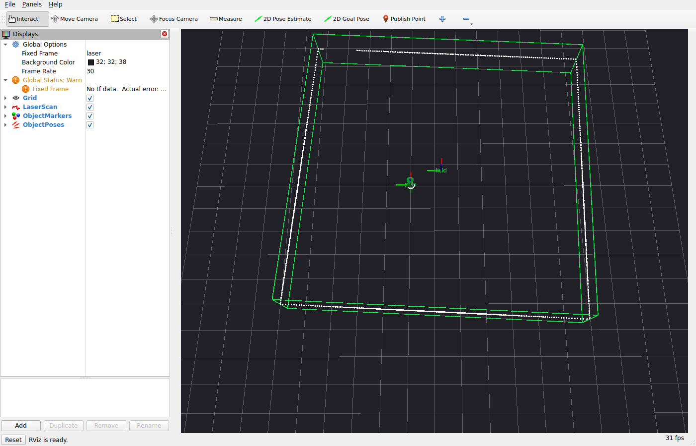

# sotoba_ros

[sotoba](https://github.com/Stew-000-1-0-011/sotoba) の点対面ICPを使い、
`/scan` (`sensor_msgs/msg/LaserScan`) から既知オブジェクト群の
**LiDAR座標系での姿勢**を推定して `Pose` を publish する ROS 2 パッケージ。

対応環境: ROS 2 Lyrical Luth / Ubuntu 26.04。
**このパッケージは C++26 でビルドする** (`CMAKE_CXX_STANDARD 26` と、
主要ターゲットへの `cxx_std_26` を明示)。sotoba 自体は C++23 以上
(deducing this / 多次元 `operator[]`) を要求するので、26 はそれを満たす。

GCC 15.2 (Lyrical の既定) で確認済み。GCC 14 でも `-std=c++26` で通る。
rosidl が生成するメッセージのコードは rosidl 側の設定で C++20 のままだが、
同じ libstdc++ ABI なので混在して問題ない。

## 構成

| ファイル | 役割 |
| --- | --- |
| `include/sotoba_ros/objects.hpp` | オブジェクトの型 (`Surface`, `ObjectDef`) と `make_objects()` の宣言 |
| `src/objects.cpp` | **オブジェクトの実体。ここを書き換えて使う** (現在は千葉大ロボコン2026フィールド) |
| `include/sotoba_ros/icp_engine.hpp` | ICPラッパのインタフェース。sotobaのICPヘッダは出てこない (pimpl) |
| `src/icp_engine.cpp` | sotobaのICPテンプレートを実体化する唯一のTU |
| `include/sotoba_ros/belief.hpp` | 信念分布 (平均 + 情報行列) と、不確かさを時間で増やす計算。ROS非依存 |
| `msg/BeliefArray.msg` | 事前/事後をやりとりする契約。外部の予測ノードとの境界 |
| `src/persistence_predictor.cpp` | 事前分布を出す最小のノード (持続予測)。sotoba_node を単体で動かすとき用 |
| `include/sotoba_ros/markers.hpp` | 形状を RViz2 の Marker にする関数の宣言 |
| `src/markers.cpp` | 形状 -> MarkerArray の変換 (ICPとは独立の別TU) |
| `include/sotoba_ros/sotoba_node.hpp` | ノード `SotobaNode` の宣言。オブジェクト群はコンストラクタで受け取る |
| `src/sotoba_node_impl.cpp` | ノードの実装 (ROSの入出力とパラメータ) |
| `src/sotoba_node.cpp` | `main()`。`make_objects()` の結果をノードへ渡す |
| `test/icp_smoke_test.cpp` | 合成スキャンでICPの収束を確認するスモークテスト (ROS不要) |
| `test/fake_scan_publisher.cpp` | `objects.cpp` の形状から合成 `/scan` と真値姿勢を流すノード |
| `test/check_poses.py` | 真値と推定を突き合わせる手動テスト |

### ほかのパッケージから形状を使う

`sotoba_ros_objects` (`objects.cpp`) は install して export してある。
同じフィールドを使うシミュレータなどは、`find_package(sotoba_ros)` して
`sotoba_ros::sotoba_ros_objects` をリンクすれば `make_objects()` を呼べる
(sotoba を FetchContent で取ってきた場合は export されない)。

### コンパイルの分割

重いのは sotoba の ICP テンプレート (曲面の型リストで実体化される) なので、
その実体化を `src/icp_engine.cpp` の1TUに閉じ込めている。
`icp_engine.hpp` は `sotoba/icp_resource/*` をインクルードしない。

結果として、

- 形状を変えた → 再コンパイルは `objects.cpp` だけ
- ノードのROS周りを変えた → 再コンパイルは `sotoba_node_impl.cpp` だけ
- `objects.hpp` の `Surface` に曲面を足した → ICPの実体化 (`icp_engine.cpp`) が再コンパイル

という切り分けになる。

## 依存

sotoba は Sophus (1.24.6 以降) を使う。`find_package(Sophus)` で見つからなければ
sotoba 側が FetchContent で取ってくるが、ネットワークに出られない環境では
先に Sophus を入れて `CMAKE_PREFIX_PATH` に置くこと。

## ビルド

sotoba は rosdep に無いので、先に install しておく。

```bash
git clone https://github.com/Stew-000-1-0-011/sotoba.git
cmake -S sotoba -B sotoba/build -DCMAKE_BUILD_TYPE=Release \
  -DCMAKE_INSTALL_PREFIX=$HOME/.local -DBUILD_DEVS=OFF \
  -DBUILD_STATIC_LIB=OFF -DBUILD_SHARED_LIB=OFF -DBUILD_MODULE_LIB=OFF
cmake --build sotoba/build --target install
```

その上でワークスペースをビルドする。

```bash
colcon build --packages-select sotoba_ros \
  --cmake-args -DCMAKE_BUILD_TYPE=Release -DCMAKE_PREFIX_PATH=$HOME/.local
```

sotoba を自前で install したくなければ、CMake側で取ってこさせてもよい。

```bash
colcon build --packages-select sotoba_ros \
  --cmake-args -DCMAKE_BUILD_TYPE=Release -DSOTOBA_ROS_FETCH_SOTOBA=ON
```

## 実行

### 実機

最小構成は **LiDAR ドライバ + sotoba_node + 事前分布を出すノード**。
sotoba_node は自分では予測をしないので、事前を出すノードが要る。
`sotoba_node.launch.py` は既定で同梱の `persistence_predictor` (持続予測) を一緒に立てる。

```bash
# LiDAR (例: UST-10LX)
ros2 launch urg_node2 urg_node2.launch.py

# 推定 (sotoba_node + persistence_predictor)。見たいなら rviz:=true。
# 別のノード (状態推定など) が事前を出すなら predictor:=false
ros2 launch sotoba_ros sotoba_node.launch.py params_file:=/path/to/sotoba_node.yaml rviz:=true
```

| ノード | 要否 | 役割 |
| --- | --- | --- |
| LiDARドライバ | 必須 | `/scan` を出す |
| `sotoba_node` | 必須 | 推定本体 |
| `persistence_predictor` | 事前を出すノードがほかに無ければ必須 | 直近の推定を、不確かさだけ増やして次の事前にする |
| `rviz2` | 確認用 | `rviz:=true` で一緒に起動 |

`fake_scan:=true` は合成スキャンを流す検証用なので、実機では**付けないこと**
(`/scan` が衝突する)。

### 実機で動かす前に必ず確認すること

**LiDAR の取付高と壁の高さ。** `lidar_height` (oumuamua では 0.14m) が `field.wall_height`
以上だと走査面が壁の上を通るので**何も見えない**。oumuamua の壁高 0.3m は
「LiDARの走査面より高くするための暫定値」で、**競技規定は 0.1m**。実物を測って
両方合わせること。ノーツも同様で、`lidar_height` が `field.note_size` 以上だと見えない。
起動時にこの2つは検算していて、危ない設定ならログにエラー/警告を出す。

**初期姿勢。** ICPの初期シード (LiDAR の初期姿勢) は、機体のスタート位置 `field.start_pose` に
LiDAR の取付 `lidar_x` / `lidar_y` / `lidar_yaw` (と `lidar_upside_down`) を足したもの。
実際の置き場所と 0.1m 程度以内で合わせること。
初期位置を横に 0.20m ずらして試したところ、収束しないどころか
対応点ゼロのまま発散した (0.05m なら誤差 0.0000m で復帰する)。
`persistence_predictor` の `reset_after_failures` を有効にしておくと初期姿勢に戻れる。

いずれもパラメータファイルの値なので、再ビルドは要らない。

### 自己位置として使う (TF)

`publish_tf: true` にすると、`tf_parent_frame` (既定 `field`) から
LiDAR のフレームへの変換を publish する。これは推定した
「フィールド→LiDAR」の逆、つまり**フィールド座標系でのLiDARの姿勢**。

URDF 等で既に LiDAR のフレームに親がいる場合は、`tf_child_frame: base_link`
のように指定する。その場合は `base_link -> スキャンのフレーム` をTFから引いて
合成した上で publish するので、TFツリーが二重親にならない。

これらは**起動時にしか読まない**ので、`ros2 param set` では切り替わらない。

### トピック

| 方向 | トピック | 型 |
| --- | --- | --- |
| sub | `scan_topic` パラメータ (既定 `/scan`) | `sensor_msgs/msg/LaserScan` |
| pub | `~/objects/<name>/pose` | `geometry_msgs/msg/PoseStamped` |
| pub | `~/object_poses` | `geometry_msgs/msg/PoseArray` |
| pub | `~/object_markers` | `visualization_msgs/msg/MarkerArray` (RViz2用、transient local) |
| pub | `~/posterior_beliefs` | `sotoba_ros/msg/BeliefArray` (全オブジェクト、名前・状態・事後情報行列) |
| pub | `~/initial_beliefs` | `sotoba_ros/msg/BeliefArray` (定義上の初期姿勢、transient local) |
| sub | `~/prior_beliefs` | `sotoba_ros/msg/BeliefArray` (事前分布。全オブジェクトぶん必須。これが来ないとスキャンを捨てる) |

publish される姿勢は「オブジェクトローカル座標系をLiDAR座標系へ写す SE3」、
すなわち **LiDARから見たオブジェクトの位置姿勢**。
`frame_id` と `stamp` は入力 `LaserScan` のものをそのまま使う。

更新に失敗したオブジェクト (対応点不足・解けなかった) は publish されず、警告が出る。

## テスト

ROSに依存しないスモークテストを1つ入れてある
(`test/icp_smoke_test.cpp`)。`objects.cpp` のオブジェクトを真値の姿勢に置き、
2D LiDAR を模したレイキャストで合成スキャンを作り、初期姿勢をシードにしたICPが
真値へ戻るかを見る。

```bash
colcon test --packages-select sotoba_ros
colcon test-result --verbose
```

どちらもオブジェクト定義には依存しないので、`objects.cpp` を書き換えても
そのまま使える (初期姿勢を少しずらしたものを真値にする)。

ノードごと動かす手動テストも入れてある。`fake_scan_publisher` が
`objects.cpp` の形状から合成スキャンを作って `/scan` へ流し、置いた真値の姿勢を
`~/truth_poses` にも出すので、`check_poses.py` がそれと推定を突き合わせる。

```bash
ros2 launch sotoba_ros sotoba_node.launch.py fake_scan:=true
python3 test/check_poses.py   # 別端末で
```

`fake_scan_publisher` は `objects.cpp` にしか依存しないので、
フィールド定義を書き換えてもそのまま使える。パラメータで
起動時のずれ (`shift_*`)、**ロボットの運動** (`motion_amplitude` /
`motion_yaw_amplitude` / `motion_period`)、光線数、距離ノイズを変えられる。
運動を入れると、事前予測が効いているかどうかを確認できる。

### 動作確認済みの環境

- ROS 2 Lyrical Luth (Ubuntu 26.04, GCC 15.2) のコンテナで
  `colcon build` / `colcon test` / 上記の手動テストが通ることを確認済み。
  ロボコン2026フィールドで、初期姿勢から (0.10, -0.06) m / 0.03 rad ずらした真値に対し、
  スモークテストの位置誤差 0.0001 m、ノードごとの手動テストで 0.003 m / 0.000 rad
  (残差はほぼ観測できないz方向)。
- RViz2 (Xvfb上のヘッドレス) で実際に表示されることも確認済み。上のスクリーンショットがそれ。

## 事前分布

ICPは前スキャンの推定を次のシードにするが、**ロボットが動くとシードが置いていかれる**。
特にノーツのような小さいオブジェクトは、自分のサイズぶん動かれると対応点を失うか、
0.2m間隔で並ぶ隣のノーツを掴む。

そこで sotoba_node は毎スキャン「事前分布」を作ってからICPを回す。
事前は**シードとしてだけでなく正規方程式そのものに入る** (sotoba 側が対応済み)。
そのため、観測できない方向は事前のまま残り、1面しか見えないオブジェクトも
1点から解ける。`use_prior: false` にすると従来どおりシードとしてだけ使う。

重要: 事前を使うと `updated` は「よく決まっている」を意味しなくなる。
見えない方向は事前がそのまま答えになるので、**下流は `~/posterior_beliefs` の
情報行列を見ること**。合成スキャンでの実測では、1面しか見えないノーツが
誤差 6.3 cm に対してその方向の σ が 3.7 cm (NEES 3.8 ≈ 1.7σ) と、
不確かさを正しく申告していた。

接空間の成分順序は sotoba (Sophus) に合わせて **(並進, 回転)**。
`tikhonov` も `initial_sigma_*` も `BeliefArray` の情報行列もこの順。

### 事前分布は外から受け取る

sotoba_node は**予測をしない**。スキャンをまたいで状態も持たない。毎スキャン、
`~/prior_beliefs` に届いている事前分布を使って解き、事後を `~/posterior_beliefs` に出すだけ。
次のスキャンの事前を作る (= 時間を進める) のは、事前を出すノードの仕事になる。
機体の動き (オドメトリ) やオブジェクト同士の関係といったアプリ固有の知識は、そちらに置く。

- 事前は**全オブジェクトぶん**入っていること。足りないメッセージは無視する
  (sotoba_node は前の結果を持ち越さないので、欠けたオブジェクトの初期値が無い)
- 事前は時刻順に `prior_buffer_duration` (既定 1 s) ぶん溜めておき、
  スキャンごとに**スキャン時刻以前で最新のもの**をそのまま使う。スキャンの時刻は撮った時刻なので
  届いた時点ですでに過去になっており、最新の事前はたいていスキャンより新しいため
- 選んだ事前とスキャンの時刻の差は埋めない。送り手は自分の推定の「今」を
  `header.stamp` に入れて、スキャン周期より十分速く出し続けること
- 使える事前が無い (まだ来ていない・どれもスキャンより新しい・`prior_timeout` より古い) ときは、
  そのスキャンを捨てて警告する
- 見失ったときの立て直しも、事前を出す側の仕事
- 起動時は `~/initial_beliefs` (定義上の初期姿勢、transient local) を出す。事前を出すノードはそこから始める

### persistence_predictor

同梱の、事前を出す最小のノード。「各オブジェクトは LiDAR から見て静止している」と仮定して、
直近の事後の平均をそのまま、不確かさだけ経過時間に応じて増やして `publish_rate` (既定 100 Hz) で出す。
まだ事後が無いうちは初期姿勢を出すので、これで循環が立ち上がる。
`reset_after_failures` 回続けて更新できなかったオブジェクトは初期姿勢に戻す。

機体の動きを知らないので、速く動くと初期値がずれて見失う。オブジェクト同士の関係も知らないので、
隠れたオブジェクトはセンサ座標系に取り残される。ロボットに載せて使うなら、機体の動きを知っているノード
(状態推定など) が事前を出すこと (`predictor:=false` で起動して、そのノードを `~/prior_beliefs` につなぐ)。

## RViz2 で見る

姿勢だけでなく形状も `~/object_markers` (MarkerArray) で出している。
バンドルした設定で RViz2 ごと起動できる。

```bash
# 実機のLiDARがあるとき
ros2 launch sotoba_ros sotoba_node.launch.py params_file:=/path/to/sotoba_node.yaml rviz:=true
# 手元で動きだけ見たいとき (合成スキャンを一緒に流す)
ros2 launch sotoba_ros sotoba_node.launch.py rviz:=true fake_scan:=true
```

(`rviz:=true` は rviz2 が入っている前提。package.xml には入れていないので、
必要なら `apt install ros-$ROS_DISTRO-rviz2`。ノード側の依存ではない)



上の画像は `fake_scan_publisher` の合成スキャンを流したもの。
緑の枠線が推定姿勢に置いたロボコン2026フィールドの壁 (外周・センターライン・
各バッフル・ビンゴ棚)、その上に乗っている白い点が `/scan`、
赤緑青の軸が `~/object_poses` の姿勢。

- 形状は**推定姿勢に置いた状態**で描かれる。スキャンの点と枠線がズレていたら、
  それがそのまま推定のズレ。
- 直近のスキャンで更新できなかったオブジェクトは灰色half透明で描かれる
  (姿勢は最後に成功した値のまま)。
- Marker は transient local で publish しているので、RViz2 を後から起動しても出る。
- ノードは TF を publish しない (全部LiDAR座標系で完結する)。
  RViz2 の Fixed Frame は LaserScan の `frame_id` に合わせること。
  TF を誰も流していないと `Frame [xxx] does not exist` と警告が出るが、表示はされる。

表示の調整は `marker_line_width` / `marker_lifetime` / `marker_normal_length` /
`marker_show_labels` / `publish_markers` で行う。

## パラメータ

**パラメータに既定値は無い。** sotoba_node も persistence_predictor も、全部パラメータファイルで与える
(足りなければ起動時にエラーで止まる)。全項目をコメント付きで並べた例が oumuamua の
`src/oumuamua_bringup/config/sotoba_node.yaml` にある。要点だけ:

- `tikhonov` (6要素, 回転3 + 並進3): **2D LiDARでは roll / pitch / z が観測できない**ので、
  該当成分 (添字 0, 1, 5) には正の値を入れておくこと。例は `[1, 1, 0.01, 0, 0, 1]`。
  yaw (添字2) の僅かな値は、円柱のような回転対称オブジェクトで正規方程式がランク落ちして
  `solve_failed` になるのを防ぐためのもの。
- `accept_distance`: 対応点として採用する距離 [m]。大きすぎると誤対応、小さすぎると収束しない。
  初期ずれが大きいときは `accept_distance_begin` を大きめにして等比で絞ると入りやすい。
- `max_points` / `point_stride`: 計算量は点数に比例する。UST-10LXなら間引かなくても足りるはず。
- `sigma_range` / `sigma_angle` / `huber_k`: 外れ値が多いときに効かせる。0で無効。
- `ray_gate` / `ray_gate_min_ratio`: 事前の姿勢で光線をモデルに当てた予測距離と実測が `ray_gate` [m] より違う点を捨てる。0で無効。
  LiDAR が傾いて壁を越えた点や床の点を、近くの壁に誤って対応付けないためのもの。事前が外れていると正しい点まで落ちるので、
  残りが `ray_gate_min_ratio` を切ったスキャンではゲートしない。
- `reset_after_failures` (persistence_predictor): 連続失敗が続いたオブジェクトを初期姿勢に戻す。0で無効。
- `publish_markers` ほか `marker_*`: RViz2 表示用。上の節を参照。

## オブジェクト定義 (フィールド)

推定する物の形は、すべてパラメータ `field.*` から作る (`src/objects.cpp`、読むのは `include/sotoba_ros/field_params.hpp`)。
千葉大ロボコン2026のフィールドの値は oumuamua の `src/oumuamua_bringup/config/field.yaml` にあり、
同じフィールドを使う他のノード (シミュレータ、作業の指示、操作画面) もそこから読む。
座標系は、原点はフィールド中心の床面、+x がスタート→ビンゴ方向、+y が左、+z が上。

| パラメータ | 意味 |
| --- | --- |
| `field.bounds` | 外周壁の内側の面 `[xmin, ymin, xmax, ymax]`。ロボットが内側にいるので `BoxInner` 1個にする |
| `field.wall_height` | 壁の高さ |
| `field.walls` | 内側の壁 (厚み込みの外形) を `[xmin, ymin, xmax, ymax]` で並べたもの。どちら側からも見えるので `BoxOuter` |
| `field.shelf` / `field.shelf_height` | ビンゴ棚 (中実の箱で近似、実際は格子)。`include_shelf: false` で外す |
| `field.notes_x` / `field.notes_y` / `field.note_size` | 自チームのノーツの中心と一辺。相手チームのノーツは y を反転した位置に作る (`include_notes: true` のとき) |
| `field.start_pose` | 機体のスタート位置 `[x, y, yaw]`。初期シードの元 |

- 全ての箱で**天板と底面を無効化**している。2D LiDAR の点は走査面上にしか無いので、
  面外法線を持つ面は誤対応の元にしかならない。
- 壁と棚は軸に平行な箱だけを書ける。斜めの壁が要るなら `objects.cpp` を拡張すること。

### 実機に合わせて要確認

- `lidar_height` は**必ず実機に合わせること**。
  ここがズレると壁の当たり方が変わる。
- 壁の高さ (`field.wall_height`) は 0.3m に暫定的に上げてある (規定値は 0.1m)。
- **ノーツ (0.15m 角) はモデル化していない**。走査面 (0.14m) にぎりぎり掛かるが、
  試合中に動くのでフィールドと同じ剛体には入れられず、個別オブジェクトにしても
  1個あたり数点しか当たらない。外れ値として `huber_k` で殴るのが現実的。
  個別に追いたい場合の書き方は `objects.cpp` にコメントで置いてある。

## オブジェクトの書き方

`src/objects.cpp` の `make_objects()` が返す `ObjectDef` の並びがそのまま推定対象になる。

```cpp
ObjectDef{
  .name = "field",                 // トピック名に使われる
  .surfaces = std::move(surfaces), // オブジェクトローカル座標系での曲面群
  .initial_pose = SE3::trans(Vec3{3.f, 0.f, 0.f}), // ICPの初期シード
}
```

- 1つの `ObjectDef` に入れた曲面は**剛体として一緒に動く**。別々に動くものは別オブジェクトにする。
- 使える曲面は `objects.hpp` の `Surface` variant に並べたもの
  (`BoxInner`, `BoxOuter`, `Rectangle`, `CylinderOuter`)。使わないものは消してよい。
- `BoxInner` はセンサが内側にいる前提の直方体で、囲い壁1個ぶんとして使える。
- ICPは前回の推定値を次のシードにするので、`initial_pose` は起動直後のだいたいの位置でよい。
  ただし大きく外すと収束しない。
- オブジェクト数は255個、曲面数は255個まで (sotoba側の制限)。

## 既知の注意点

- 2D LiDAR の1スキャンは平面上の点しか無いので、面外自由度 (z, roll, pitch) は
  原理的に決まらない。`tikhonov` で拘束するか、そもそも面外に効く形状を置かないこと。
- sotoba の README/メモにもある通り、景色の対称性が高いとICPの解は飛ぶことがある。
  後段で異常値処理をすること (本ノードは面倒を見ない)。
- **シードは真の形状より手前に置かないこと**。sotoba の `closest_pdn` は
  センサ原点から見えない最近接点を距離無限で捨てるので、真の表面がシード形状の
  裏側に回ると対応点が丸ごと消える。実際、ポール (半径0.15m) のシードを真値の
  0.3m 手前に置くと対応点が3点しか残らず `too_few_correspondences` になった。
  同じずれでもシードを奥に置いた場合は問題なく収束する。
  小さくて凸なオブジェクトほどシードの精度が要る。
- 点群容量は最初のスキャンで確定し、それを超えるスキャンが来たらエンジンを作り直す
  (その際は推定済み姿勢を引き継ぐ)。恒常的に作り直しが起きるなら `max_points` を見直すこと。
